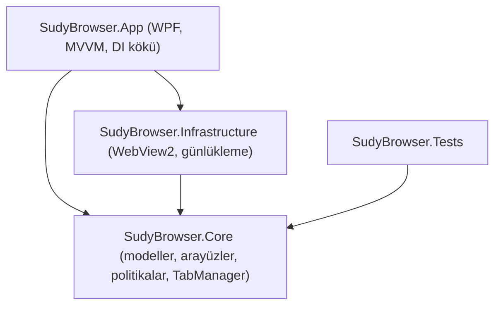
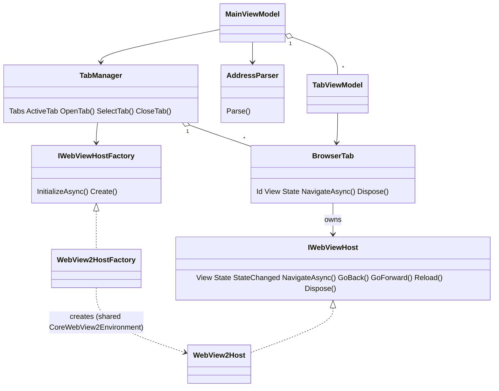

# Mimari

## Katmanlar

- **Core** WPF ve WebView2'ye bağımlı değildir (yalnızca `Microsoft.Extensions.Logging.Abstractions`). Tüm tarayıcı mantığı burada test edilebilir.
- **Infrastructure** WebView2'ye özgü her şeyi `IWebViewHost` / `IWebViewHostFactory` arayüzlerinin arkasında barındırır.
- **App** yalnızca sunum ve bileşim kökünü içerir. ViewModel'ler WebView2 API'sini bilmez.

## Sınıflar ve ilişkileri

- `WebView2HostFactory` uygulama başında tek bir `CoreWebView2Environment` oluşturur; runtime yoksa `BrowserEngineUnavailableException` fırlatır ve `App` kullanıcıya mesaj gösterir.
- Her sekme tek bir `BrowserTab` ve onun tek `IWebViewHost`'una sahiptir. Sekme kapanınca `TabManager` önce `TabClosed` olayını yayar (arayüz kontrolü ağaçtan çıkarır), ardından tab'ı dispose eder; host olaylardan çıkar ve `WebView2` kontrolünü dispose eder.
- Host durum değişikliklerini (`NavigationState`: URL, başlık, geri/ileri, yükleniyor) olay ile yayar; `TabViewModel` bunu bağlanabilir özelliklere çevirir.
- Tüm WebView2 kontrolleri `WebViewHostPanel` içinde aynı hücrede yığılır; yalnızca etkin olan görünürdür. Böylece arka plan sekmeleri durumunu korur ve kontroller yeniden ebeveynlenmez.
- Tüm API'ler UI thread'inden kullanılır (WebView2 ve WPF gereği).

## Gelecek: MemoryManager

`MemoryManager` Core katmanında (`Services/`) yer alacak ve `TabManager`'ın olaylarına (`TabOpened`, `TabClosed`, `ActiveTabChanged`) abone olacaktır. Sekme yaşam döngüsü tek noktada (`TabManager`) olduğu için:

- Etkin olmayan sekmeleri belirli süre sonra askıya alma kararı (politika) Core'da `Policies/` altında yazılır.
- Askıya alma eylemi `IWebViewHost`'a eklenecek yeni üyelerle (ör. `SuspendAsync`/`ResumeAsync`, `CoreWebView2.TrySuspendAsync` ile) Infrastructure'da uygulanır; arayüz katmanı değişmez.
- Bir sekmenin tamamen boşaltılması (kontrolü dispose edip yalnızca URL'yi tutma) `BrowserTab` içinde host'u yeniden oluşturarak yapılabilir; `View` özelliği bu nedenle sekme üzerinden okunur.
- `MemoryManager` DI'a singleton olarak eklenir ve `TabManager`'a bağımlıdır; `TabManager` ona bağımlı olmaz.
